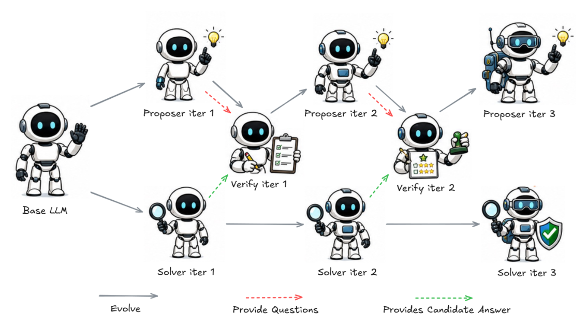
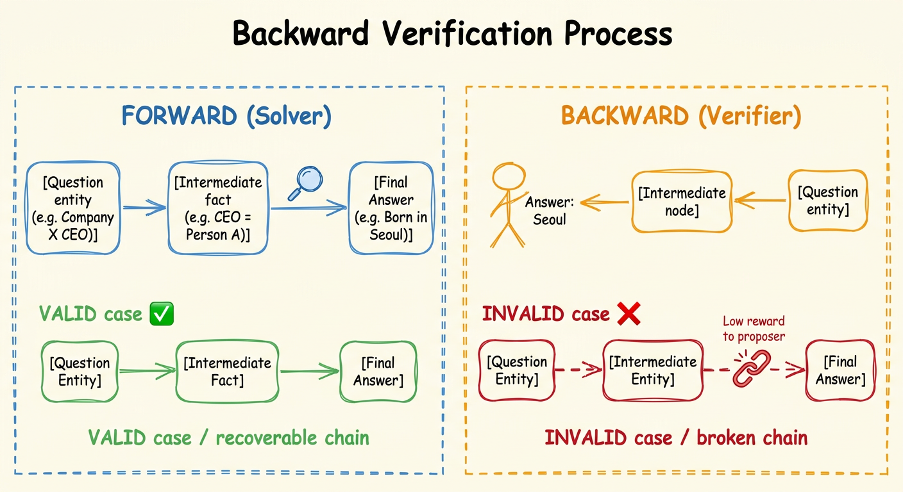
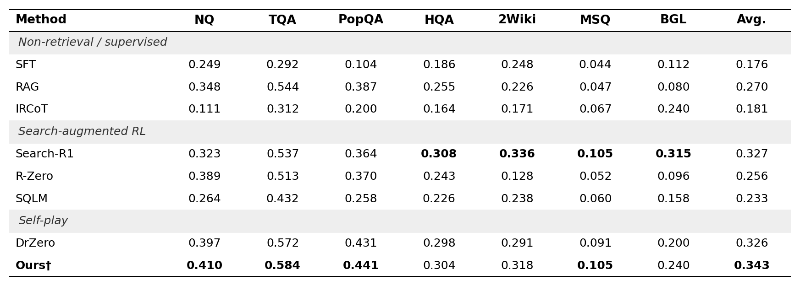

<div align="center">



# 강화학습 기반 자기 대전을 통한 다중 홉 질의응답 역추론 성능 향상

**Don't Just Ask — Verify: Rethinking Reward Signals for Self-Play Multi-hop QA**

조재헝 · 윤재욱 · 이상호 · 하승구 · 정의량 · 나욱진

현대자동차그룹 CVLCM AI팀

[](https://gitlab.hmc.co.kr/cvlcmai/2026_hmc_paper/vef_zero)
[](https://arxiv.org/abs/2601.07055)
[](https://www.python.org/downloads/)

</div>

---

## 개요

Self-play 프레임워크는 어려운 질문을 생성하는 **제안자(Proposer)**와 이를 푸는 **해결자(Solver)**를 공동 학습시키지만, 제안자의 보상이 단순히 solver의 실패율에만 의존할 경우 **논리적으로 불완전하거나 근거가 약한 질문**을 생성하는 방향으로 학습될 수 있습니다.

본 연구에서는 DrZero 프레임워크에 **역방향 검증자(Backward Verifier)**를 도입합니다. 검증자는 hop 체인을 역방향으로 추적하는 검색 기반 추론을 통해, 답변에서 출발하여 원래 질문의 시작 엔티티까지 복원되지 않는 질문에 대해 제안자에게 패널티를 부여합니다.

---

## 핵심 아이디어



기존 접근법은 solver가 정답을 맞히는지(순방향)만 검증합니다. 본 연구는 **역방향 검증**을 추가합니다:

- **유효한 질문**: 정답에서 역방향 추적 시 질문의 시작 엔티티까지 회복 가능
- **유효하지 않은 질문**: 역방향 추적 실패 → 제안자에게 낮은 보상

---

## 실험 결과



7개 QA 벤치마크에서 DrZero 대비 일관된 성능 향상:

| 지표 | DrZero | **Ours** |
|---|---|---|
| 평균 Exact Match | 0.326 | **0.343** |
| LLM-Judge 유효성 | 16.1% | **25.3%** |
| HNR | 60.7% | **69.7%** |

---

## 환경 설정

Python 환경에 PyTorch, transformers, faiss-gpu, verl==0.5.0 등이 필요합니다. 의존성 목록은 [여기](https://github.com/volcengine/verl/blob/v0.5.0/requirements.txt)와 [여기](https://github.com/volcengine/verl/blob/v0.5.0/requirements_sglang.txt)를 참조하세요.

---

## 데이터 및 검색 엔진 준비

Wikipedia 영문 덤프를 다운로드하고 retriever 인덱스를 구축합니다 (기본: `intfloat/e5-base-v2`).

```bash
save_path=./corpus
python scripts/download.py --save_path $save_path
cat $save_path/part_* > $save_path/e5_Flat.index
gzip -d $save_path/wiki-18.jsonl.gz
```

초기 학습/평가 데이터 준비:

```bash
python process_train.py --local_dir ./data
python process_test.py --local_dir ./data
```

---

## 학습 실행

각 iteration은 **Proposer → 데이터 생성 → Solver → Verifier** 순서로 진행됩니다.

### Iteration 1

```bash
# 1. Proposer 학습
bash iter1_challenger.sh

# 2. 학습 데이터 생성
bash iter1_gen_data.sh

# 3. Solver 학습
bash iter1_solver.sh

# 4. Solver 체크포인트 변환 (HF 포맷)
bash convert.sh

# 5. Verifier 학습 (본 연구 추가 단계)
bash iter1_verifier.sh
```

### Iteration 2, 3...

```bash
# Iter 2
bash iter2_challenger.sh && bash iter2_gen_data.sh && bash iter2_solver.sh && bash convert.sh && bash iter2_verifier.sh

# Iter 3
bash iter3_challenger.sh && bash iter3_gen_data.sh && bash iter3_solver.sh && bash convert.sh && bash iter3_verifier.sh
```

---

## 코드 구조

```
├── iter{1,2,3}_challenger.sh       # Proposer 학습
├── iter{1,2,3}_gen_data.sh         # 학습 데이터 생성
├── iter{1,2,3}_solver.sh           # Solver 학습
├── iter{1,2,3}_verifier.sh         # Verifier 학습 (본 연구)
├── verl/custom_reward/
│   ├── reward_function.py          # Proposer 보상 함수
│   └── verifier_reward_function.py # Verifier 보상 함수 (본 연구)
├── scripts/data_process/
│   └── verifier_data.py            # Verifier 학습 데이터 생성 (본 연구)
├── LLMjudge/                       # LLM 기반 질문 품질 평가
└── search/                         # 검색 서버
```

---

## 인용

본 연구의 기반인 DrZero를 인용할 경우:

```bibtex
@article{yue2026dr,
  title={Dr. Zero: Self-Evolving Search Agents without Training Data},
  author={Yue, Zhenrui and Upasani, Kartikeya and Yang, Xianjun and Ge, Suyu and Nie, Shaoliang and Mao, Yuning and Liu, Zhe and Wang, Dong},
  journal={arXiv preprint arXiv:2601.07055},
  year={2026}
}
```

---

## 라이선스

비상업적 라이선스 하에 배포됩니다. 자세한 내용은 [LICENSE](LICENSE.md)를 참조하세요.

## 감사의 말

본 코드는 [Search-R1](https://github.com/PeterGriffinJin/Search-R1)과 [VeRL](https://github.com/volcengine/verl)을 기반으로 구현되었습니다.

---

<div align="center">
현대자동차그룹 CVLCM AI팀 | 2026 사내 학술대회
</div>
